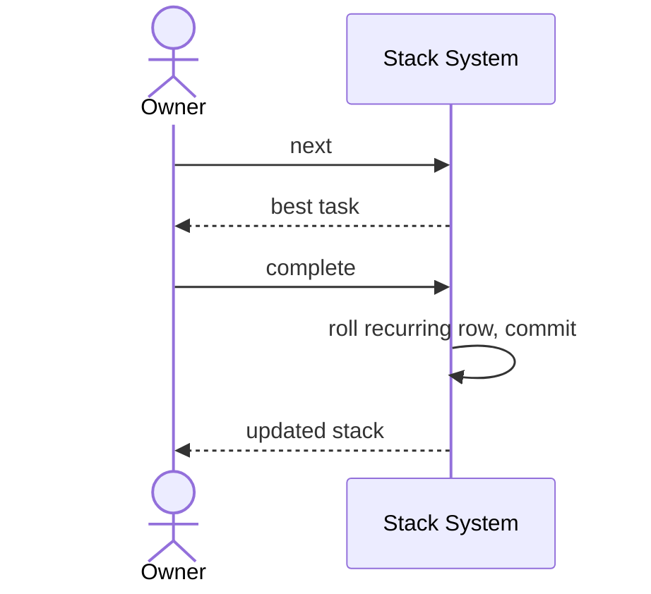
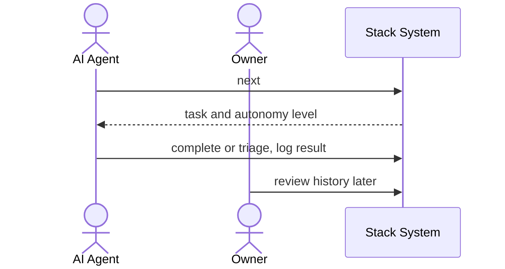
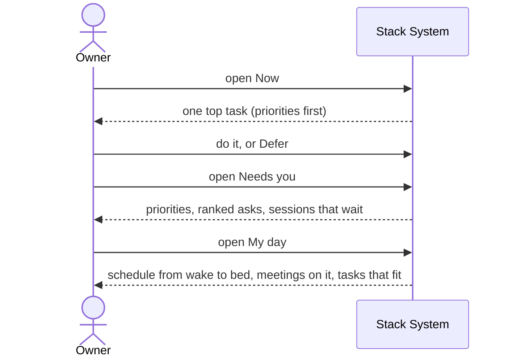
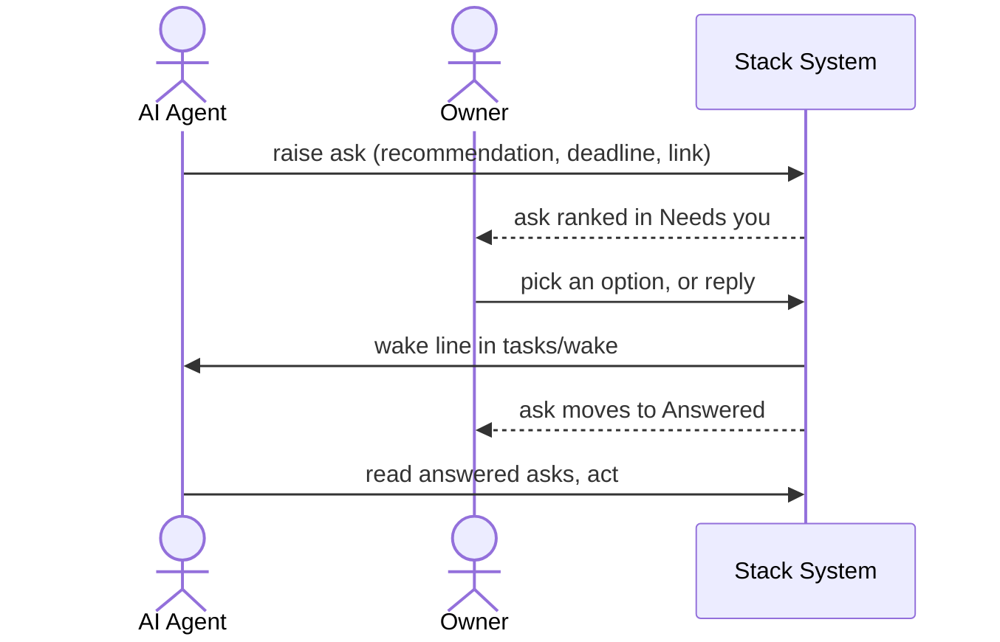
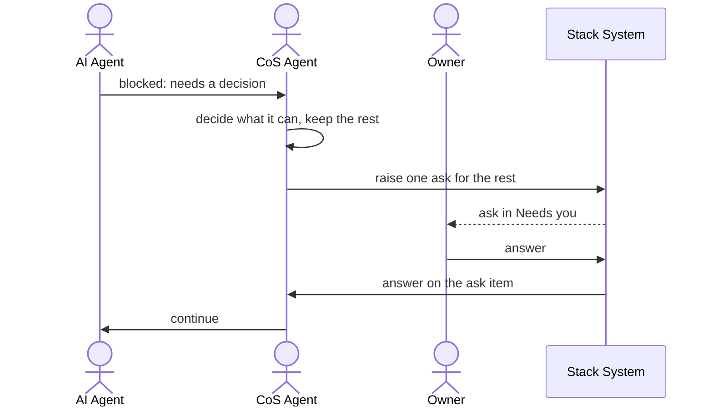

# Customer Journey

## Work the next task

Owner asks Stack what to do next, acts on it, and marks it done. Stack scores the stack, commits the change, and rolls recurring rows.

## Agent triage

AI Agent reads the next task, works within its autonomy level, and records the result. It never merges or deploys; Owner reviews asynchronously.

## Morning

Owner opens Stack, does the one top task, answers the decisions that wait, then plans the rest of the day around meetings. Scenarios: `FR:next-task`, `FR:needs-you`, `FR:my-day`, `FR:priorities`.

## Answer an ask

An agent or the mail triage raises a decision. Owner answers it in one step. Stack wakes the agent; the agent reads the answer. The ask shows as Answered until the agent acts. Scenarios: `FR:needs-you`, `FR:inbox-zero`.

## Agent escalation via CoS

A worker agent hits a decision it cannot make. The CoS agent checks it, decides what it can, and escalates only the rest. Owner sees one ask, not the agent traffic. Scenarios: `FR:needs-you`, `FR:sessions`.

