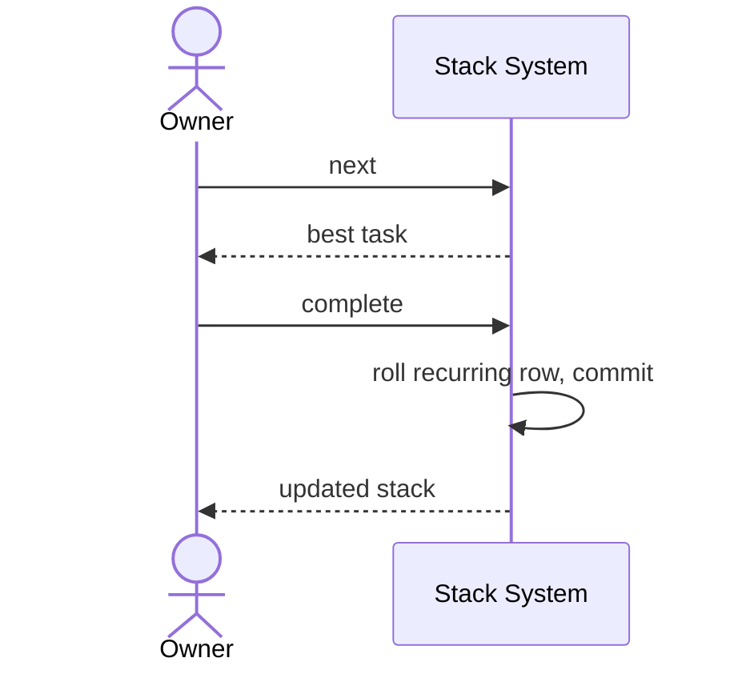
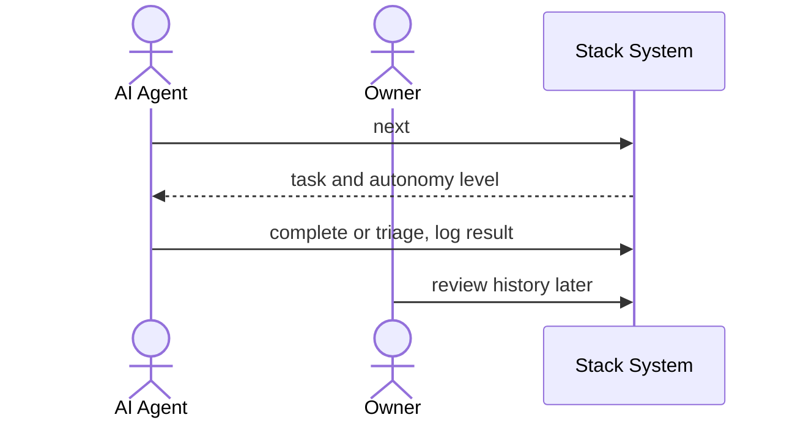

# Customer Journey

## Work the next task

Owner asks Stack what to do next, acts on it, and marks it done. Stack scores the stack, commits the change, and rolls recurring rows.

## Agent triage

AI Agent reads the next task, works within its autonomy level, and records the result. It never merges or deploys; Owner reviews asynchronously.

