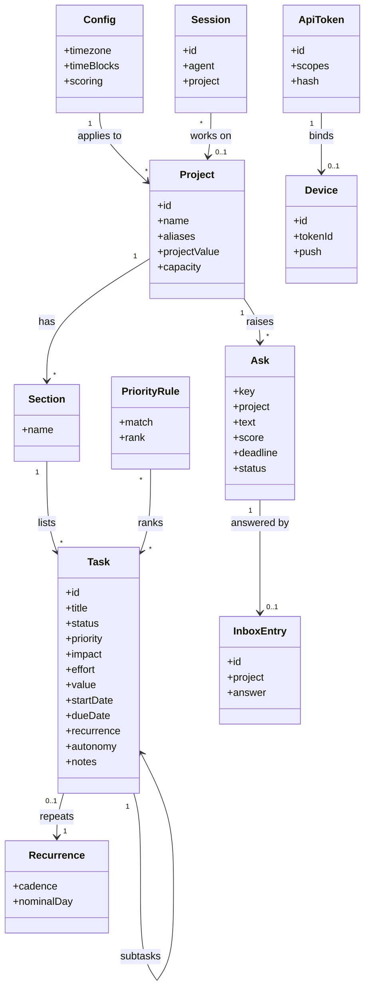

# Blueprint: Stack

<!-- markdownlint-disable single-title -->

<!-- Source of truth for dependencies is each spec frontmatter. Updated 2026-11-10 by the Catalyst conformance check (issue 4). -->

## Architecture

```mermaid
graph TD
  subgraph core[Core]
    task-model
    task-parser
    recurring-rows
    config
    scoring-engine
    task-lifecycle
    summaries
    formatter-clean
    storage-git
  end
  subgraph surfaces[Surfaces]
    cli
    api
    auth-security
    mcp-server
    chat-bots
    azure-host
  end
  subgraph ux[Experience]
    web-app
    web-shell
    pwa
    quick-capture
    quick-triage
    schedule
    home
    now-screen
    top-asks
    cos-view
    ux-consolidation
    desktop-app
    desktop-shell
    iphone-access
  end
  subgraph agents[Agents and asks]
    ask-queue
    agent-inbox
    agent-sessions
    agent-team
    agents-team
    agent-thread
    acp-driver
    ai-triage-assist
    query-tasks
    scoring-bakeoff
    auto-priority
    github-pr-status
  end
  subgraph comms[Comms]
    email-triage
    email-voice
    email-inbox-zero
    email-runner
    graph-signin
    day-inputs
    inbox-page
    connector-github
    comms-connectors
  end
  subgraph ops[Delivery]
    deploy-docs
    live-deploy
    autopilot
    catalyst-adoption
    perf
    test-reliability
  end
  config --> recurring-rows
  scoring-engine --> task-parser
  scoring-engine --> config
  task-lifecycle --> scoring-engine
  task-lifecycle --> recurring-rows
  task-lifecycle --> task-parser
  task-lifecycle --> storage-git
  task-lifecycle --> config
  summaries --> scoring-engine
  summaries --> config
  summaries --> task-parser
  cli --> task-lifecycle
  cli --> summaries
  cli --> storage-git
  cli --> config
  formatter-clean --> task-parser
  formatter-clean --> config
  api --> task-lifecycle
  api --> summaries
  api --> storage-git
  auth-security --> api
  quick-capture --> api
  quick-capture --> task-lifecycle
  quick-capture --> recurring-rows
  web-app --> api
  web-app --> auth-security
  web-app --> quick-capture
  pwa --> web-app
  pwa --> ask-queue
  schedule --> config
  schedule --> day-inputs
  schedule --> api
  home --> schedule
  home --> day-inputs
  home --> web-app
  now-screen --> home
  now-screen --> web-app
  top-asks --> web-app
  top-asks --> home
  top-asks --> ask-queue
  top-asks --> task-lifecycle
  web-shell --> web-app
  web-shell --> ask-queue
  web-shell --> pwa
  web-shell --> agent-sessions
  web-shell --> live-deploy
  ux-consolidation --> now-screen
  ux-consolidation --> cos-view
  ux-consolidation --> home
  ux-consolidation --> web-shell
  desktop-app --> pwa
  desktop-app --> web-shell
  desktop-app --> live-deploy
  desktop-app --> cli
  desktop-shell --> cli
  desktop-shell --> web-app
  desktop-shell --> pwa
  desktop-shell --> acp-driver
  iphone-access --> auth-security
  iphone-access --> api
  iphone-access --> ask-queue
  iphone-access --> pwa
  iphone-access --> azure-host
  perf --> cli
  perf --> api
  perf --> scoring-engine
  perf --> web-app
  mcp-server --> api
  mcp-server --> auth-security
  query-tasks --> task-lifecycle
  chat-bots --> api
  scoring-bakeoff --> scoring-engine
  auto-priority --> scoring-engine
  auto-priority --> scoring-bakeoff
  ai-triage-assist --> mcp-server
  agent-inbox --> api
  agent-inbox --> ai-triage-assist
  agent-inbox --> storage-git
  agent-inbox --> auth-security
  agent-inbox --> github-pr-status
  ask-queue --> api
  ask-queue --> storage-git
  ask-queue --> agent-inbox
  ask-queue --> auth-security
  ask-queue --> web-app
  agent-sessions --> ask-queue
  agent-sessions --> api
  agent-sessions --> auth-security
  agent-sessions --> web-app
  agent-sessions --> task-model
  agent-team --> agent-sessions
  agent-team --> ask-queue
  agent-team --> agent-inbox
  agent-team --> ai-triage-assist
  agent-team --> api
  agent-team --> auth-security
  agent-team --> storage-git
  agent-team --> web-app
  agents-team --> agent-team
  agents-team --> agent-sessions
  agents-team --> web-app
  agent-thread --> agent-team
  agent-thread --> agent-sessions
  agent-thread --> agent-inbox
  agent-thread --> ask-queue
  agent-thread --> ai-triage-assist
  agent-thread --> api
  agent-thread --> auth-security
  agent-thread --> web-app
  agent-thread --> web-shell
  acp-driver --> agent-sessions
  acp-driver --> ask-queue
  acp-driver --> cli
  quick-triage --> ask-queue
  quick-triage --> task-lifecycle
  quick-triage --> web-shell
  email-triage --> ask-queue
  email-triage --> ai-triage-assist
  email-voice --> email-triage
  email-inbox-zero --> email-triage
  email-inbox-zero --> email-voice
  email-inbox-zero --> ask-queue
  graph-signin --> day-inputs
  graph-signin --> email-triage
  graph-signin --> cli
  day-inputs --> email-triage
  day-inputs --> ask-queue
  day-inputs --> web-app
  day-inputs --> api
  email-runner --> email-triage
  email-runner --> email-voice
  email-runner --> email-inbox-zero
  email-runner --> graph-signin
  email-runner --> day-inputs
  inbox-page --> email-triage
  inbox-page --> email-inbox-zero
  inbox-page --> email-voice
  inbox-page --> ask-queue
  inbox-page --> web-shell
  connector-github --> inbox-page
  connector-github --> ask-queue
  connector-github --> comms-connectors
  comms-connectors --> inbox-page
  comms-connectors --> ask-queue
  cos-view --> web-app
  cos-view --> home
  cos-view --> ask-queue
  cos-view --> top-asks
  cos-view --> day-inputs
  deploy-docs --> api
  deploy-docs --> mcp-server
  deploy-docs --> auth-security
  deploy-docs --> chat-bots
  deploy-docs --> cli
  azure-host --> api
  azure-host --> auth-security
  azure-host --> mcp-server
  azure-host --> chat-bots
  azure-host --> storage-git
  live-deploy --> azure-host
  live-deploy --> storage-git
  live-deploy --> ask-queue
  live-deploy --> pwa
  live-deploy --> deploy-docs
  autopilot --> deploy-docs
  catalyst-adoption --> config
```

## Data Model



## Roadmap

Goal: a secure, $0-cost, anywhere-accessible task system (git markdown truth, Azure Static Web Apps host) that tells the owner what to do next and lets AI work the stack. The legacy system is the parity target; agents never touch it.

Phases follow `.xe/product.md` Product Strategy. Waves are dependency levels within a phase. Phase 2 and 3 interleave: the Now, Home, and shell features (Phase 2) build on the ask queue (Phase 3), so a Phase 2 wave can wait on a Phase 3 feature. iphone-access, web-shell, and desktop-app also wait on Phase 4 hosting (azure-host, live-deploy). now-screen and ux-consolidation also depend on stack-app, which has no spec yet.

```mermaid
gantt
  title Roadmap
  dateFormat X
  axisFormat %s
  section Phase 1
    task-model :task_model, 0, 1
    task-parser :task_parser, 0, 1
    recurring-rows :recurring_rows, 0, 1
    storage-git :storage_git, 0, 1
    config :config, after recurring_rows, 1
    scoring-engine :scoring_engine, after task_parser config, 1
    task-lifecycle :task_lifecycle, after scoring_engine recurring_rows task_parser storage_git config, 1
    summaries :summaries, after scoring_engine config task_parser, 1
    cli :cli, after task_lifecycle summaries storage_git config, 1
  section Phase 2
    formatter-clean :formatter_clean, after task_parser config, 1
    api :api, after task_lifecycle summaries storage_git, 1
    auth-security :auth_security, after api, 1
    quick-capture :quick_capture, after api task_lifecycle recurring_rows, 1
    web-app :web_app, after api auth_security quick_capture, 1
    perf :perf, after cli api scoring_engine web_app, 1
    pwa :pwa, after web_app ask_queue, 1
    iphone-access :iphone_access, after auth_security api ask_queue pwa azure_host, 1
    schedule :schedule, after config day_inputs api, 1
    web-shell :web_shell, after web_app ask_queue pwa agent_sessions live_deploy, 1
    desktop-shell :desktop_shell, after cli web_app pwa acp_driver, 1
    home :home, after schedule day_inputs web_app, 1
    desktop-app :desktop_app, after pwa web_shell live_deploy cli, 1
    now-screen :now_screen, after home web_app, 1
    top-asks :top_asks, after web_app home ask_queue task_lifecycle, 1
    ux-consolidation :ux_consolidation, after now_screen cos_view home web_shell, 1
  section Phase 3
    github-pr-status :github_pr_status, 0, 1
    scoring-bakeoff :scoring_bakeoff, after scoring_engine, 1
    query-tasks :query_tasks, after task_lifecycle, 1
    auto-priority :auto_priority, after scoring_engine scoring_bakeoff, 1
    chat-bots :chat_bots, after api, 1
    mcp-server :mcp_server, after api auth_security, 1
    ai-triage-assist :ai_triage_assist, after mcp_server, 1
    agent-inbox :agent_inbox, after api ai_triage_assist storage_git auth_security github_pr_status, 1
    ask-queue :ask_queue, after api storage_git agent_inbox auth_security web_app, 1
    agent-sessions :agent_sessions, after ask_queue api auth_security web_app task_model, 1
    email-triage :email_triage, after ask_queue ai_triage_assist, 1
    agent-team :agent_team, after agent_sessions ask_queue agent_inbox ai_triage_assist api auth_security storage_git web_app, 1
    acp-driver :acp_driver, after agent_sessions ask_queue cli, 1
    email-voice :email_voice, after email_triage, 1
    day-inputs :day_inputs, after email_triage ask_queue web_app api, 1
    agents-team :agents_team, after agent_team agent_sessions web_app, 1
    email-inbox-zero :email_inbox_zero, after email_triage email_voice ask_queue, 1
    graph-signin :graph_signin, after day_inputs email_triage cli, 1
    agent-thread :agent_thread, after agent_team agent_sessions agent_inbox ask_queue ai_triage_assist api auth_security web_app web_shell, 1
    quick-triage :quick_triage, after ask_queue task_lifecycle web_shell, 1
    email-runner :email_runner, after email_triage email_voice email_inbox_zero graph_signin day_inputs, 1
    inbox-page :inbox_page, after email_triage email_inbox_zero email_voice ask_queue web_shell, 1
    comms-connectors :comms_connectors, after inbox_page ask_queue, 1
    connector-github :connector_github, after inbox_page comms_connectors ask_queue, 1
    cos-view :cos_view, after web_app home ask_queue top_asks day_inputs, 1
  section Phase 4
    test-reliability :test_reliability, 0, 1
    catalyst-adoption :catalyst_adoption, after config, 1
    deploy-docs :deploy_docs, after api mcp_server auth_security chat_bots cli, 1
    azure-host :azure_host, after api auth_security mcp_server chat_bots storage_git, 1
    autopilot :autopilot, after deploy_docs, 1
    live-deploy :live_deploy, after azure_host storage_git ask_queue pwa deploy_docs, 1
```



### Phase 1: POC

_Core and CLI at legacy parity, byte-exact round-trip, golden-tested scoring._

#### Wave 1.1

- **task-model** — [spec](task-model/spec.md)
- **task-parser** — [spec](task-parser/spec.md)
- **recurring-rows** — [spec](recurring-rows/spec.md)
- **storage-git** — [spec](storage-git/spec.md)

#### Wave 1.2

- **config** — [spec](config/spec.md)

#### Wave 1.3

- **scoring-engine** — [spec](scoring-engine/spec.md)

#### Wave 1.4

- **task-lifecycle** — [spec](task-lifecycle/spec.md)
- **summaries** — [spec](summaries/spec.md)

#### Wave 1.5

- **cli** — [spec](cli/spec.md)

### Phase 2: Mainstream

_Access from anywhere with a secure UI that beats editing text, on web, desktop, and phone._

#### Wave 2.1

- **formatter-clean** — [spec](formatter-clean/spec.md)

#### Wave 2.2

- **api** — [spec](api/spec.md)

#### Wave 2.3

- **auth-security** — [spec](auth-security/spec.md)
- **quick-capture** — [spec](quick-capture/spec.md)

#### Wave 2.4

- **web-app** — [spec](web-app/spec.md)

#### Wave 2.5

- **perf** — [spec](perf/spec.md)

#### Wave 2.6

- **pwa** — [spec](pwa/spec.md)

#### Wave 2.7

- **iphone-access** — [spec](iphone-access/spec.md)

#### Wave 2.8

- **schedule** — [spec](schedule/spec.md)
- **web-shell** — [spec](web-shell/spec.md)
- **desktop-shell** — [spec](desktop-shell/spec.md)

#### Wave 2.9

- **home** — [spec](home/spec.md)
- **desktop-app** — [spec](desktop-app/spec.md) (partial: PWA install shipped; native shell moved to desktop-shell)

#### Wave 2.10

- **now-screen** — [spec](now-screen/spec.md)
- **top-asks** — [spec](top-asks/spec.md)

#### Wave 2.11

- **ux-consolidation** — [spec](ux-consolidation/spec.md)

### Phase 3: Innovation

_Agents, bots, and comms work the stack and bring only the asks that need the owner._

#### Wave 3.1

- **github-pr-status** — [spec](github-pr-status/spec.md)

#### Wave 3.2

- **scoring-bakeoff** — [spec](scoring-bakeoff/spec.md)

#### Wave 3.3

- **query-tasks** — [spec](query-tasks/spec.md)
- **auto-priority** — [spec](auto-priority/spec.md)

#### Wave 3.4

- **chat-bots** — [spec](chat-bots/spec.md)

#### Wave 3.5

- **mcp-server** — [spec](mcp-server/spec.md)

#### Wave 3.6

- **ai-triage-assist** — [spec](ai-triage-assist/spec.md)

#### Wave 3.7

- **agent-inbox** — [spec](agent-inbox/spec.md)

#### Wave 3.8

- **ask-queue** — [spec](ask-queue/spec.md)

#### Wave 3.9

- **agent-sessions** — [spec](agent-sessions/spec.md)
- **email-triage** — [spec](email-triage/spec.md)

#### Wave 3.10

- **agent-team** — [spec](agent-team/spec.md)
- **acp-driver** — [spec](acp-driver/spec.md)
- **email-voice** — [spec](email-voice/spec.md)
- **day-inputs** — [spec](day-inputs/spec.md)

#### Wave 3.11

- **agents-team** — [spec](agents-team/spec.md)
- **email-inbox-zero** — [spec](email-inbox-zero/spec.md)
- **graph-signin** — [spec](graph-signin/spec.md)

#### Wave 3.12

- **agent-thread** — [spec](agent-thread/spec.md) (partial: 21 of 31 requirements traced)
- **quick-triage** — [spec](quick-triage/spec.md)
- **email-runner** — [spec](email-runner/spec.md)
- **inbox-page** — [spec](inbox-page/spec.md)

#### Wave 3.13

- **comms-connectors** (Medium) — one connector contract for chat and social sources (Teams, Slack, LinkedIn) that feeds the Inbox page and asks
  - Scope: in: connector interface, build order from research; out: posting on the owner's behalf
  - Dependencies: inbox-page, ask-queue
  - Open questions: spec not written yet; see [research](comms-connectors/research.md) and [build order](comms-connectors/build-order.md)

#### Wave 3.14

- **connector-github** — [spec](connector-github/spec.md)
- **cos-view** — [spec](cos-view/spec.md)

### Phase 4: Platform

_Deployable, documented, always on, and free-tier, with the merge and spec flow automated._

#### Wave 4.1

- **test-reliability** — [spec](test-reliability/spec.md)

#### Wave 4.2

- **catalyst-adoption** — [spec](catalyst-adoption/spec.md) (in progress: pilot partial, see check-report.md)

#### Wave 4.3

- **deploy-docs** — [spec](deploy-docs/spec.md)
- **azure-host** — [spec](azure-host/spec.md)

#### Wave 4.4

- **autopilot** — [spec](autopilot/spec.md)

#### Wave 4.5

- **live-deploy** — [spec](live-deploy/spec.md)

### Phase 5: Enterprise and Phase 6: Scale

_Planned when Phase 4 completes: multi-user, sharing, DB adapter, Xe Prime integration._
