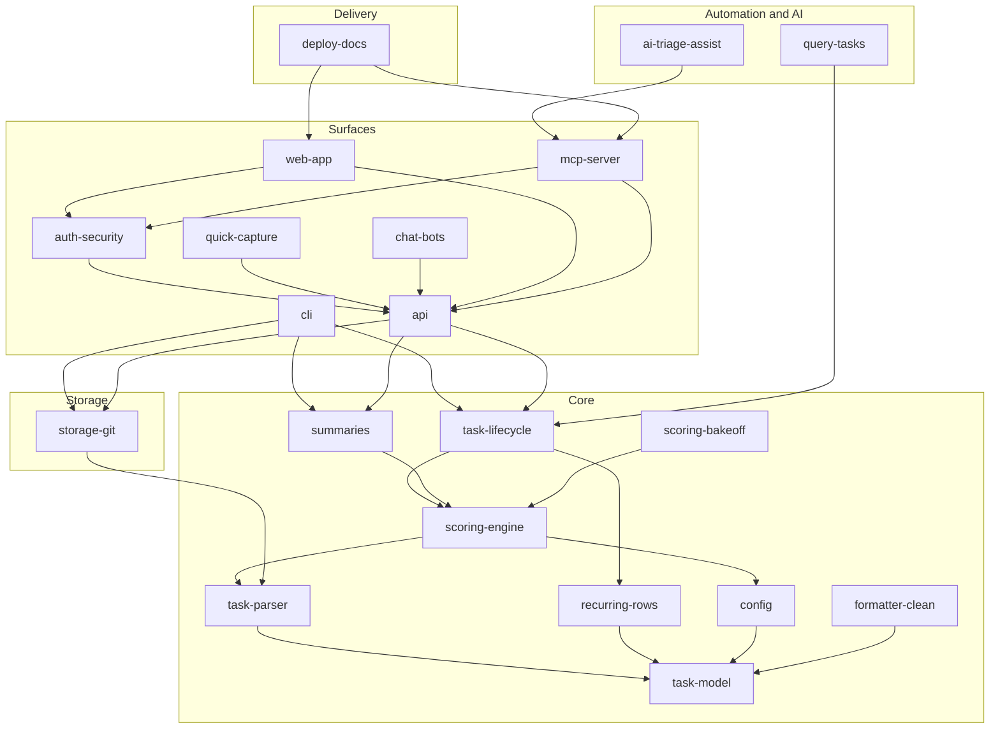
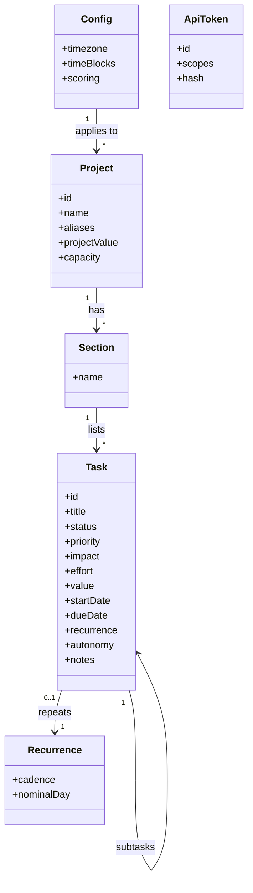

# Blueprint: Stack

<!-- markdownlint-disable single-title -->

## Architecture

## Data Model

## Roadmap

Goal: a secure, $0-cost, anywhere-accessible task system (git markdown truth, Azure Static Web Apps host) that tells the owner what to do next and lets AI work the stack. Legacy `~/dev/todo` is the parity target; agents never touch it.

```mermaid
gantt
  title Roadmap
  dateFormat X
  axisFormat %s
  section Phase 1
    task-model :tm, 0, 1
    task-parser :tp, after tm, 2
    recurring-rows :rr, after tm, 2
    config :cf, after tm, 2
    scoring-engine :se, after tp cf, 3
    storage-git :sg, after tp, 3
    task-lifecycle :tl, after se rr, 4
    summaries :sm, after se, 4
    cli :cl, after tl sm sg, 5
  section Phase 2
    formatter-clean :fc, after cl, 6
    api :ap, after cl, 6
    auth-security :as, after ap, 7
    web-app :wa, after as, 8
    quick-capture :qc, after ap, 7
  section Phase 3
    mcp-server :ms, after as, 8
    query-tasks :qt, after tl, 7
    chat-bots :cb, after ap, 7
    scoring-bakeoff :sb, after se, 5
    ai-triage-assist :ai, after ms, 9
  section Phase 4
    deploy-docs :dd, after wa ms, 10
```

### Phase 1: POC

_Core and CLI at legacy parity, byte-exact round-trip, golden-tested scoring._

#### Wave 1.1

- **task-model** (Medium) — format-neutral Task/Project/Section/Recurrence types and validation
  - Scope: in: types, validation, autonomy field; out: parsing, IO
  - Dependencies: none

#### Wave 1.2

- **task-parser** (Large) — lossless emoji-markdown parse/serialize
  - Scope: in: byte-exact round-trip on legacy files, quirks (BOM, blockquotes, metadata bullets); out: storage
  - Dependencies: task-model. Existing work: PR 7
- **recurring-rows** (Medium) — cadence roll for 🔄 rows
  - Scope: in: daily..yearly, weekday names, `Quarterly-EOM+1`, both row forms, no weekend drift, subtask reset; out: wiring to complete
  - Dependencies: task-model. Existing work: PR 6
- **config** (Small) — legacy config shape, defaults, time blocks, weights
  - Scope: in: parse/validate/defaults, active time block; out: file IO
  - Dependencies: task-model. Built: PR 10

#### Wave 1.3

- **scoring-engine** (Large) — pluggable engine, default legacy formula
  - Scope: in: weights, project value, placement, effort divisor, time filtering, goldens from legacy; out: redesign
  - Dependencies: task-parser, config
- **storage-git** (Medium) — storage interface plus git adapter
  - Scope: in: atomic reads/writes, direct commits, conflict handling; out: DB adapter
  - Dependencies: task-parser

#### Wave 1.4

- **task-lifecycle** (Large) — start, complete, skip/park, resume, suspend, set-properties, remove-completed, add-project, add-task, ⏰/💤 sweeps
  - Scope: in: all ops, recurring roll on complete; out: surfaces
  - Dependencies: scoring-engine, recurring-rows
- **summaries** (Medium) — README, stack, projects, my-day
  - Scope: in: generation parity with legacy; out: delivery
  - Dependencies: scoring-engine

#### Wave 1.5

- **cli** (Large) — full CLI
  - Scope: in: init, add-project, add, next, start, complete, skip, resume, suspend, set, remove-completed, update; out: web
  - Dependencies: task-lifecycle, summaries, storage-git

### Phase 2: Mainstream

_Access from anywhere with a secure, easier-than-text UI._

#### Wave 2.1

- **formatter-clean** (Medium) — clean YAML/structured formatter and dual output
  - Scope: in: second formatter, selectable per repo; out: migration of legacy data
  - Dependencies: cli
- **api** (Medium) — REST over core
  - Scope: in: all core flows, token-efficient responses; out: auth
  - Dependencies: cli

#### Wave 2.2

- **auth-security** (Large) — SWA auth allow-list, hashed scoped API tokens, threat model, security tests
  - Scope: in: deny by default, token lifecycle; out: multi-user
  - Dependencies: api
- **quick-capture** (Medium) — natural-language and speech add
  - Scope: in: parse "call dentist tomorrow 30m"; out: AI triage
  - Dependencies: api

#### Wave 2.3

- **web-app** (Large) — desktop keyboard-first and mobile touch UI
  - Scope: in: next-task view, pickers/chips, command palette, full list/filters, capacity view, inline markdown editor, drag/reorder, bulk edit; out: native apps
  - Dependencies: api, auth-security

### Phase 3: Innovation

_Agents and bots operate the stack._

#### Wave 3.1

- **mcp-server** (Medium) — token-efficient MCP tools
  - Scope: in: next, add, complete, triage tools; out: autonomy logic
  - Dependencies: api, auth-security
- **query-tasks** (Medium) — 🔎 GitHub-sourced generated subtasks
  - Scope: in: 🌐 prefix, failure leaves list untouched; out: other sources
  - Dependencies: task-lifecycle
- **chat-bots** (Medium) — iMessage/Slack, webhooks, GitHub Actions hooks
  - Scope: in: message in, task out, "what's next"; out: new channels
  - Dependencies: api
- **scoring-bakeoff** (Medium) — redesigned engine plus comparison report (separate agent)
  - Scope: in: alternative engine, real-data comparison; out: replacing default without approval
  - Dependencies: scoring-engine

#### Wave 3.2

- **ai-triage-assist** (Large) — triage and autonomy-bounded execution
  - Scope: in: 🪄/🙋 subtasks, per-task autonomy, logged results; out: silent completion beyond autonomy
  - Dependencies: mcp-server

### Phase 4: Platform

_Deployable and documented._

- **deploy-docs** (Medium) — Bicep/SWA workflow, runbook, API/MCP reference, e2e CI
  - Scope: in: build-only IaC, docs; out: production deploy by agents
  - Dependencies: web-app, mcp-server

### Phase 5: Enterprise and Phase 6: Scale

_Planned when Phase 4 completes: multi-user, sharing, DB adapter, Xe Prime integration._
