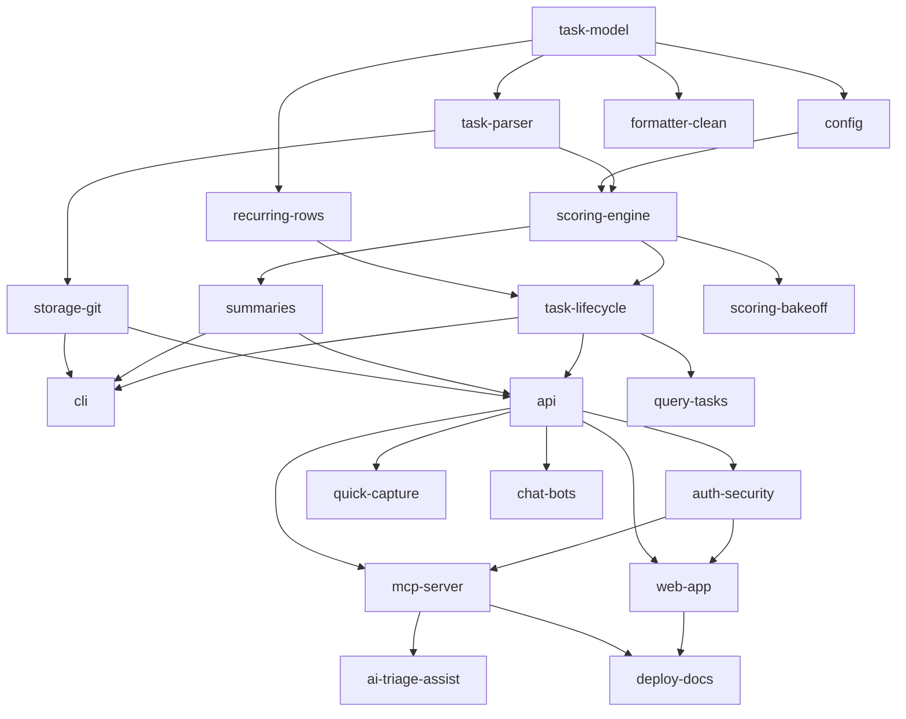

# Implementation Plan: Stack Product Blueprint

**Spec**: [Blueprint spec](./spec.md)

## Summary

Features are built phase by phase, tier by tier, each as one draft PR via `/catalyst:rollout`, spec and tests first, reviewed by a separate agent via `/catalyst:pr-loop`. An orchestrator agent runs create → review → fix until clean. Agents never merge or deploy.

## Technical Context

Architecture in `.xe/architecture.md`; blueprint decisions in `spec.md`. TypeScript core (`src/core`), CLI (`src/cli`), Azure SWA web + Functions API/MCP. Jest; Playwright for e2e.

## Data Model

Feature: `id` (kebab), `phase`, `tier`, `dependencies[]`, `scope`, `complexity` (S/M/L), `priority`.

## Features

| # | ID | Phase | Tier | Deps | Scope | Size | Status |
| - | -- | ----- | ---- | ---- | ----- | ---- | ------ |
| 1 | task-model | 1 POC | 0 | - | Format-neutral Task/Project/Section/Config types and validation | M | |
| 2 | task-parser | 1 | 1 | task-model | Lossless emoji-markdown parse/serialize, byte-exact on legacy files | L | PR 7 |
| 3 | recurring-rows | 1 | 1 | task-model | Cadence roll, no-drift, both row forms | M | PR 6 |
| 4 | config | 1 | 1 | task-model | Legacy config shape, defaults, time blocks, weights | S | |
| 5 | scoring-engine | 1 | 2 | task-parser, config | Pluggable engine; default legacy formula; goldens | L | |
| 6 | task-lifecycle | 1 | 3 | scoring-engine, recurring-rows | start/complete/skip/resume/suspend/set/remove/add, sweeps | L | |
| 7 | summaries | 1 | 3 | scoring-engine | README/stack/projects/my-day generation | M | |
| 8 | storage-git | 1 | 2 | task-parser | Storage interface + git adapter, direct commits, atomic | M | |
| 9 | cli | 1 | 4 | task-lifecycle, summaries, storage-git | Full CLI incl. init/add-project/update | L | |
| 10 | formatter-clean | 2 Mainstream | 2 | task-model | Clean YAML formatter, dual output | M | |
| 11 | api | 2 | 4 | task-lifecycle, summaries, storage-git | REST over core | M | |
| 12 | auth-security | 2 | 4 | api | SWA auth allow-list, API tokens, threat model, security tests | L | |
| 13 | web-app | 2 | 5 | api, auth-security | Desktop keyboard-first + mobile touch UI, pickers, palette, capture, editor, capacity | L | |
| 14 | quick-capture | 2 | 5 | api | NLP + speech add | M | |
| 15 | mcp-server | 3 Innovation | 5 | api, auth-security | Token-efficient MCP tools | M | |
| 16 | query-tasks | 3 | 4 | task-lifecycle | 🔎 GitHub query subtasks | M | |
| 17 | ai-triage-assist | 3 | 5 | mcp-server | Triage and autonomy-bounded execution | L | |
| 18 | chat-bots | 3 | 5 | api | iMessage/Slack, webhooks, GitHub Actions | M | |
| 19 | scoring-bakeoff | 3 | 3 | scoring-engine | Redesigned engine + comparison report (separate agent) | M | |
| 20 | deploy-docs | 4 Platform | 6 | web-app, mcp-server | Bicep/SWA workflow, runbook, API/MCP reference, e2e CI | M | |

Phase 5 (Enterprise: multi-user, sharing, DB adapter) and Phase 6 (Scale: Xe Prime integration) are planned when Phase 4 completes.

## Constraints

Dependency order. One slice per draft PR. Never merge. Do not modify `~/dev/todo`.
