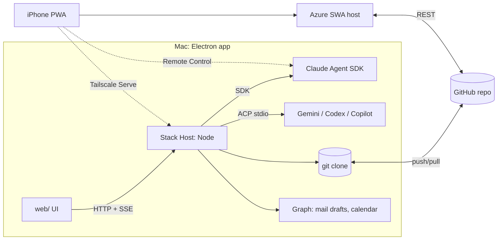

# Research: ACP-based Stack app architecture

Question: what app shape lets Stack act as an AI Chief of Staff on ACP, on Mac first, Windows/Linux later, and iPhone?
Date: 2026-11-05. Method: Catalyst explore conventions, followed by hand (the `catalyst:explore` skill did not load in this agent session). "Verified" = read in the cited source. "Est." = not verified; test before relying. Docs only: no spec or code change.

## TL;DR

- ACP is the link between a **host process** and agents over stdio. It is not a link between a UI and the host. A browser cannot spawn agents, but a web UI on a local Node host can.
- So the owner's concern is half right: a hosted web app **alone** does not work. A web UI in a desktop shell, with a local Node host that is the ACP client, does.
- Recommend: **Stack Host** (existing `stack web` Node host, now an ACP client) + **Electron** shell on Mac + **iPhone PWA** on the Azure host, with git asks as the offline path and Tailscale Serve as the live path to the Mac.

## 1. ACP

| Topic                    | Finding                                                                                                                                                                                  | Status                          | Src       |
| ------------------------ | ---------------------------------------------------------------------------------------------------------------------------------------------------------------------------------------- | ------------------------------- | --------- |
| What                     | JSON-RPC 2.0 protocol between a client (editor/app) and a coding agent; "LSP for agents"; reuses MCP JSON types                                                                          | Verified                        | [1]       |
| Roles                    | Client: spawns agent, owns UI, answers `session/request_permission`, may give fs/terminal. Agent: owns model, tools, auth                                                                | Verified                        | [1][4][5] |
| Transport                | stdio is the only defined transport: client spawns agent as subprocess, newline-delimited JSON-RPC                                                                                       | Verified                        | [2]       |
| Remote                   | Streamable HTTP is "being specified"; remote support is "a work in progress"; Transports Working Group formed 2026-04-22                                                                 | Verified (draft)                | [1][2][3] |
| Auth                     | Agent lists `authMethods` in `initialize`; if non-empty, it must implement `auth/login` and `auth/logout`; client may offer `auth.terminal`                                              | Verified (v2 draft)             | [4]       |
| Version                  | Integer major `protocolVersion`; agent picks highest it supports up to the request                                                                                                       | Verified                        | [4]       |
| TS SDK                   | `@agentclientprotocol/sdk`: `ClientSideConnection` + `ndJsonStream`                                                                                                                      | Verified; API varies by version | [6]       |
| Claude                   | `@agentclientprotocol/claude-agent-acp` (Apache-2.0), built on Claude Agent SDK; session list/resume only in v2 mode; MCP, terminals, permissions                                        | Verified                        | [7]       |
| Gemini CLI               | Listed with no adapter (appears native)                                                                                                                                                  | Est. native                     | [8]       |
| Codex                    | Adapter `agentclientprotocol/codex-acp`                                                                                                                                                  | Verified                        | [8]       |
| Copilot CLI              | ACP support in public preview                                                                                                                                                            | Verified                        | [8]       |
| Zed (client)             | Runs each agent as a separate process; custom agents in `agent_servers` (`command`, `args`, `env`); agent owns its own auth (`/login`)                                                   | Verified                        | [9]       |
| Other clients            | 100+ listed, including mobile clients (Happy, Agmente, Mobvibe, Shellular)                                                                                                               | Verified                        | [10]      |
| Mobile pattern           | Happy: CLI wraps the agent on the desktop; encrypted relay server; native iOS/Android apps; push through APNs/FCM worker; MIT                                                            | Verified (high level)           | [11]      |
| Claude's own mobile path | Remote Control: local session, outbound HTTPS only, routed through Anthropic API; phone via Claude app or claude.ai/code; push for "actions required"; needs claude.ai plan, no API keys | Verified                        | [12]      |

Implications:

- The Stack host spawns agents. One host per machine. The UI talks to the host over HTTP + SSE, as `stack web` does today.
- Phone-to-agent cannot be ACP today (no remote transport). It must be Stack's own API, a relay, or Claude Remote Control.
- Existing decision stands with one change: `AgentDriver` stays ACP-shaped; add an `AcpDriver` (stdio) for Gemini, Codex, Copilot. Claude stays on the SDK driver (the adapter is the same SDK plus one more process) ([design-decisions](../design-decisions.md), "Drive agents through the Claude Agent SDK").

## 2. Desktop shell

| Need                               | PWA (PR 86) | Electron                                                                                                                             | Tauri 2                                                             | Native Swift                   |
| ---------------------------------- | ----------- | ------------------------------------------------------------------------------------------------------------------------------------ | ------------------------------------------------------------------- | ------------------------------ |
| Runs Node host + spawns ACP agents | No          | Yes: main process is Node; host in `utilityProcess` (stdin not supported there, so the host spawns agents with `child_process`) [13] | Only as a sidecar binary; Rust side reads/writes sidecar stdio [14] | Only as a bundled Node sidecar |
| Reuse `web/` (Preact) UI           | Yes         | Yes, as is                                                                                                                           | Yes (system WebKit)                                                 | No: rebuild UI                 |
| Tray, global hotkey, login item    | No          | Yes [15]                                                                                                                             | Yes, plugins [15]                                                   | Yes, best fit                  |
| Notifications                      | Yes         | Yes                                                                                                                                  | Plugin                                                              | Yes                            |
| Size                               | 0           | ~85-244 MB [15]                                                                                                                      | ~3-9 MB shell [15]                                                  | Small shell                    |
| Size after Agent SDK               | n/a         | + ~263 MB native binary                                                                                                              | + same 263 MB + Node sidecar                                        | + same                         |
| Windows/Linux later                | Yes         | Yes                                                                                                                                  | Yes                                                                 | No                             |
| New toolchain                      | None        | None                                                                                                                                 | Rust                                                                | Swift                          |
| Signing                            | None        | $99/yr Apple account, notarize (human) [15]                                                                                          | Same [15]                                                           | Same                           |

Reconcile with PR 86 ([desktop-app research](../desktop-app/research.md)): PR 86 picked PWA because Stack then ran on the Azure host and agents were optional. With ACP as the base, the Mac must keep a long-lived host that spawns agents. A PWA cannot own that host. Tauri's size edge is gone, because the Agent SDK binary (263 MB, [design-decisions](../design-decisions.md)) dwarfs either shell. Electron keeps one language (TS), runs the host in-process, and reuses the UI. **Change: Electron replaces the deferred Tauri choice.** The PWA stays for iPhone and for any browser.

## 3. iPhone

| Option                        | Push                                                                                                 | Reach desktop agents          | Cost to build          | Verdict                                            |
| ----------------------------- | ---------------------------------------------------------------------------------------------------- | ----------------------------- | ---------------------- | -------------------------------------------------- |
| PWA (existing, Azure host)    | Web Push on iOS 16.4+ only when added to Home Screen; every push is visible; no background sync [16] | Through git asks or Stack API | ~0 (built)             | **First**                                          |
| Expo / React Native           | APNs through Expo or own worker [11]                                                                 | Same                          | Medium; second UI      | Later, only if PWA push fails                      |
| SwiftUI                       | Full APNs, widgets, Live Activities, Shortcuts                                                       | Same                          | High; second UI, Swift | Later, for widgets/Siri                            |
| Claude app via Remote Control | Yes [12]                                                                                             | Direct, Claude only           | 0                      | Use for live Claude sessions; deep link from Stack |

How the phone reaches desktop agents:

| Path                    | How                                                                                                        | Mac asleep?          | Exposure                         | Verdict                                                                           |
| ----------------------- | ---------------------------------------------------------------------------------------------------------- | -------------------- | -------------------------------- | --------------------------------------------------------------------------------- |
| Git asks (exists)       | Phone answers asks on Azure host; commit to `main`; Mac host pulls and resumes the agent                   | Queued; runs on wake | None new                         | **Default**                                                                       |
| Tailscale Serve         | Phone on tailnet opens the Mac host; HTTPS cert; `Tailscale-User-Login` identity header; tailnet-only [17] | Fails                | Tailnet only (never Funnel [18]) | **Live view** (stream, cancel)                                                    |
| Own relay (Happy-style) | Encrypted relay in Azure                                                                                   | Fails                | Public endpoint                  | Reject: build cost; Tailscale does it                                             |
| Cloud agent host        | Agents run on Azure                                                                                        | Works                | Secrets in cloud                 | Later; violates "token stays on Mac" ([design-decisions](../design-decisions.md)) |
| Claude Remote Control   | Anthropic routes                                                                                           | Fails                | Anthropic                        | Claude only; complement                                                           |

Auth: Azure host keeps SWA GitHub sign-in + owner allow-list ([hosting](../../../docs/hosting.md)). Mac host binds to localhost; Tailscale Serve fronts it; host trusts `Tailscale-User-Login` only from localhost and checks it against the owner list [17].

## 4. Sync and data

| Concern            | Design                                                                                                                                                | Src                                        |
| ------------------ | ----------------------------------------------------------------------------------------------------------------------------------------------------- | ------------------------------------------ |
| Source of truth    | Markdown in the private git repo (unchanged)                                                                                                          | [product](../../product.md)                |
| Mac host           | Local clone; writes are commits; push/pull on a timer and on focus                                                                                    | Est. design                                |
| Azure host / phone | GitHub REST; one commit per write; fast-forward-only ref update; rebuild on a new head                                                                | [hosting](../../../docs/hosting.md)        |
| Offline Mac        | Full: local commits, push later                                                                                                                       | Est.                                       |
| Offline phone      | Read-only cache; writes need a connection (existing non-goal)                                                                                         | [hosting](../../../docs/hosting.md)        |
| Conflicts          | One file per ask avoids most; for task files, rebase and reapply the operation (not the text) on a new head; byte-exact round-trip makes reapply safe | Est.; needs a test                         |
| Agent state        | ACP/SDK transcripts stay on the Mac; never in git                                                                                                     | [design-decisions](../design-decisions.md) |

## 5. Security

| Risk                                    | Control                                                                                                                                                                |
| --------------------------------------- | ---------------------------------------------------------------------------------------------------------------------------------------------------------------------- |
| Agent runs a harmful tool               | Every ACP `session/request_permission` becomes an ask; task autonomy level sets which `kind`s auto-allow; `allow_always` is per project, revocable                     |
| Mail is sent                            | No `Mail.Send` scope; guard allows only `createReply` drafts; agents never get the Graph token; they draft only through Stack MCP tools (`FR:email-runner/cli.nosend`) |
| Secrets leak                            | Graph and GitHub tokens in macOS Keychain (Electron `safeStorage`, est.) or 0600 files; never in repo, never in agent `env`; host scrubs agent env to an allowlist     |
| Prompt injection (mail, socials, tasks) | Inbound text is data; render as text; agents told so; draft-only for any outbound channel                                                                              |
| Remote access                           | Tailscale tailnet only; no inbound port; no Funnel; owner identity check                                                                                               |
| Agent auth                              | Each agent owns its login (ACP `authMethods`); Stack never stores agent keys                                                                                           |
| Socials                                 | Read-only APIs first; posting stays draft + human send. API access per network is uncertain (not researched)                                                           |

## Recommended architecture

## Smallest first slice

1. `AcpDriver` in `src/agents/` with `@agentclientprotocol/sdk`: `initialize`, `session/new`, `session/prompt`, `session/update`, `session/request_permission` to ask, `session/cancel`. Test against Gemini CLI. No UI change: the Agents view already reads the driver.
2. Then: Electron shell that starts `stack web` in-process, plus tray, `Cmd+Shift+Space` capture, login item. Unsigned local build first; signing is a human step.
3. Then: Tailscale Serve doc + identity check for the live phone view.

## Risks

| Risk                                                  | Impact                       | Mitigation                                             |
| ----------------------------------------------------- | ---------------------------- | ------------------------------------------------------ |
| ACP v2 and remote transport are drafts                | API churn                    | Pin SDK version; keep `AgentDriver` as the seam        |
| Mac asleep or off                                     | No live agents from phone    | Git asks queue; later a cloud runner                   |
| Two Claude paths (SDK + adapter)                      | Drift                        | Claude stays on SDK only                               |
| iOS PWA push needs Home Screen install; no background | Missed pings                 | Fall back to Claude Remote Control push; SwiftUI later |
| Electron size and updates                             | Large download, updater work | Single user; accept                                    |
| Apple signing                                         | Human gate ($99/yr)          | Unsigned dev build until needed                        |
| Git conflicts across devices                          | Lost edit                    | Operation replay on new head; test before ship         |

## Sources

1. ACP introduction: https://agentclientprotocol.com/overview/introduction
2. ACP v2 transports: https://agentclientprotocol.com/protocol/v2/transports.md
3. Transports Working Group: https://agentclientprotocol.com/announcements/transports-working-group
4. ACP v2 initialization (auth, version): https://agentclientprotocol.com/protocol/v2/initialization.md
5. ACP tool calls and permissions: https://agentclientprotocol.com/protocol/v2/tool-calls.md
6. ACP TypeScript SDK: https://agentclientprotocol.com/libraries/typescript and https://github.com/agentclientprotocol/typescript-sdk
7. Claude ACP adapter: https://github.com/zed-industries/claude-agent-acp
8. ACP agents list: https://agentclientprotocol.com/overview/agents
9. Zed external agents: https://zed.dev/docs/ai/external-agents
10. ACP clients list: https://agentclientprotocol.com/overview/clients
11. Happy (mobile client, relay, push): https://github.com/slopus/happy
12. Claude Code Remote Control: https://code.claude.com/docs/en/remote-control
13. Electron utilityProcess: https://www.electronjs.org/docs/latest/api/utility-process
14. Tauri sidecar: https://v2.tauri.app/develop/sidecar/
15. Shell features, size, signing: sources 2-11 in [desktop-app research](../desktop-app/research.md)
16. iOS web push limits (vendor summaries; check WebKit notes): https://www.magicbell.com/blog/pwa-ios-limitations-safari-support-complete-guide
17. Tailscale Serve: https://tailscale.com/kb/1312/serve
18. Tailscale Funnel: https://tailscale.com/kb/1223/funnel
